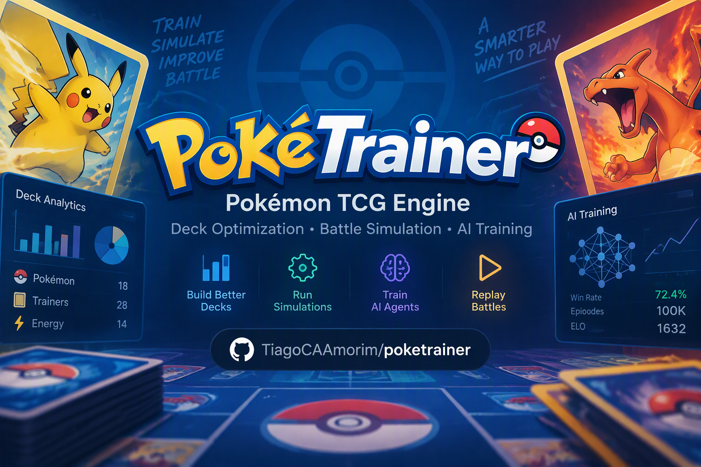

<p align="center">
  
</p>

# PTCG Lab

Um simulador de **Pokémon TCG** (com as regras do Pokémon TCG Live) para você **jogar, montar e testar decks**
no seu computador, sem precisar programar. Cobre o formato **Padrão TEF–30C** (marcas H, I e J): as 2.083 cartas
estão implementadas, com textos em inglês e português.

Você usa tudo por uma página no navegador. O terminal só é necessário para instalar e para ligar o programa.

> 🖨️ **Só quer imprimir as cartas de um deck?** Use a página online, sem instalar nada:
> **[Gerar PDF de cartas simplificadas](https://tiagocaamorim.github.io/poketrainer/)** (inglês ou português,
> com os 16 melhores decks de cada torneio da temporada).

---

## 1. Instalar (uma vez só)

Você precisa de **Python 3.10 ou mais novo** ([python.org/downloads](https://www.python.org/downloads/);
no Windows marque *"Add python.exe to PATH"*) e do **Git** ([git-scm.com](https://git-scm.com/downloads)).
Abra um terminal (no Windows: *Windows Terminal* ou *PowerShell*) e digite:

```
git clone https://github.com/TiagoCAAmorim/poketrainer
cd poketrainer
python -m venv .venv
```

Ative o ambiente (isso é preciso **toda vez** que abrir um terminal novo para usar o programa):

| Sistema | Comando |
|---|---|
| Windows (PowerShell) | `.venv\Scripts\Activate.ps1` |
| Windows (cmd) | `.venv\Scripts\activate.bat` |
| Linux / macOS | `source .venv/bin/activate` |

Instale o que o programa usa:

```
pip install numpy reportlab pillow
```

Opcional, para jogar contra as **IAs treinadas** (níveis 1 a 9): `pip install torch`
(versão leve, sem placa de vídeo: `pip install torch --index-url https://download.pytorch.org/whl/cpu`).
Sem o PyTorch tudo funciona, só não aparecem as IAs treinadas — a IA "heurística" (nível 0) continua disponível.

> Sem Git? Em github.com/TiagoCAAmorim/poketrainer clique em **Code → Download ZIP**, extraia e abra o terminal dentro da pasta.
> No Windows, se `python` não funcionar, use `py`.

## 2. Baixar as imagens das cartas (recomendado)

As imagens não vêm junto com o programa. Sem elas tudo funciona, mas as cartas aparecem como quadros de texto.

```
python baixar_imagens.py
```

Leva alguns minutos e ocupa cerca de 190 MB. Pode ser interrompido e retomado (ele pula o que já baixou).
Quer rápido? `python baixar_imagens.py --qualidade baixa` baixa só as miniaturas. Mais opções em [CARTAS.md](CARTAS.md).

## 3. Abrir a interface gráfica

```
python server.py
```

O navegador abre sozinho em **http://localhost:8765** (se não abrir, digite esse endereço).
Para encerrar, volte ao terminal e aperte `Ctrl+C`.

**Decks para começar:** já vêm 12 decks de torneio (Mundial 2026 e Regional de Louisville). Para trazer mais
(top 8 dos últimos torneios da Limitless, precisa de internet), em outro terminal:

```
python import_limitless.py import --latest 5
```

---

## Atualizar o programa

Quando sair uma versão nova, a **página inicial** mostra o aviso "🔔 Nova versão disponível". Clique em **Atualizar agora**:
o programa baixa o código e as IAs novas, reinicia sozinho e a página recarrega. Funciona igual se você instalou por Git
ou por ZIP, e **seus decks, logs e imagens não são tocados**. Sem a interface: `python atualizar.py`.

## O que dá para fazer na interface

A página inicial mostra seis atalhos:

| Atalho | Para quê |
|---|---|
| ⚔️ **Jogar / simular** (`/jogar`) | Escolha dois decks e quem controla cada lado: **você**, a **IA heurística**, uma jogada **aleatória** ou uma **IA treinada** (níveis 1–9). Dá para jogar, assistir IA × IA, desfazer jogadas, revelar as mãos, ajustar a velocidade e pedir **sugestões da IA** durante a partida. |
| 💬 **Comentar** (dentro da partida) | Achou que o simulador errou uma regra? Descreva na hora: o comentário guarda a partida inteira até aquele ponto, para o erro poder ser reproduzido e corrigido. |
| 🃏 **Montar e editar decks** (`/decks`) | Monte um deck buscando cartas por nome e categoria, ou puxando cartas de outro deck. Salve, duplique qualquer deck para a sua coleção e copie a lista no formato do TCG Live. |
| 🔎 **Explorar as cartas** (`/cartas`) | Filtre as 2.083 cartas (nome em inglês ou português, tipo, estágio, coleção…), veja a imagem grande, ataques, Habilidades, fraqueza, evoluções e todas as impressões. |
| 🧪 **Testar um deck** (`/testar`) | Seu deck joga contra todos os outros da base e mostra: taxa de vitória (indo em 1º ou em 2º), cartas e combos que mais ajudam, em que vez saem os Prêmios, matchups difíceis e **trocas de cartas sugeridas**. Pode salvar a versão melhorada. |
| 🖨️ **Imprimir cartas (PDF)** (`/imprimir`) | Parta de um deck, acrescente ou tire cartas e gere um PDF em escala reduzida (ex.: 90%), com imagens ou em versão simplificada preto e branco. Escolha papel A4, Office, A5… |
| 📜 **Reproduzir um log do TCG Live** | No TCG Live use **Copy Log** na partida e cole o texto aqui: o simulador refaz cada jogada, confere dano e nocautes e aponta onde as regras divergem. |

---

## Problemas comuns

| Sintoma | O que fazer |
|---|---|
| `ModuleNotFoundError: No module named 'numpy'` | O ambiente não está ativado (veja o passo 1) ou falta `pip install numpy reportlab pillow`. |
| `ModuleNotFoundError: No module named 'ptcg'` | Rode os comandos de dentro da pasta `poketrainer`. |
| A porta 8765 está ocupada | `python server.py --port 9000` e abra `http://localhost:9000`. |
| O navegador não abre sozinho (no WSL aparecem várias linhas "not found") | Abra `http://localhost:8765` no navegador do Windows. Para abrir automaticamente: `sudo apt install wslu` e `export BROWSER=wslview`; ou use `python server.py --no-browser`. |
| Acentos estranhos no terminal do Windows | Use o Windows Terminal ou digite `chcp 65001` antes. |
| `import_limitless.py` falha | Sem internet, ou a Limitless mudou o site. |

Mais detalhes e testes de conferência: [INSTALACAO.md](INSTALACAO.md).

---

## Para saber mais

| Documento | Conteúdo |
|---|---|
| [CHANGELOG.md](CHANGELOG.md) | Novidades de cada versão |
| [CARTAS.md](CARTAS.md) | Página de cartas e todas as opções de download de imagens |
| [DECKS.md](DECKS.md) | Importar, limpar (fora da rotação), alterar e criar decks |
| [INSTALACAO.md](INSTALACAO.md) | Instalação detalhada, testes de conferência e solução de problemas |
| [docs/COMANDOS.md](docs/COMANDOS.md) | Todos os comandos de terminal (decks, cartas, logs, simulação, impressão) |
| [docs/TECNICO.md](docs/TECNICO.md) | Estrutura de pastas, arquitetura do motor, cobertura de cartas, testes |
| [docs/IA_TREINO.md](docs/IA_TREINO.md) | Como as IAs são treinadas · [progresso](docs/IA_PROGRESSO.md) · [novo computador](docs/IA_NOVO_COMPUTADOR.md) |
| [PLANO.md](PLANO.md) | Plano do projeto, o que está pronto e os próximos passos |

---

> **Aviso:** o PTCG Lab é um **projeto pessoal, sem fins lucrativos e sem nenhuma associação com a The Pokémon Company**,
> a Nintendo, a Creatures ou a Game Freak. Pokémon e os nomes, textos e imagens das cartas pertencem aos seus
> respectivos donos; as imagens são baixadas de sites públicos e devem ser usadas só para estudo e uso pessoal.
